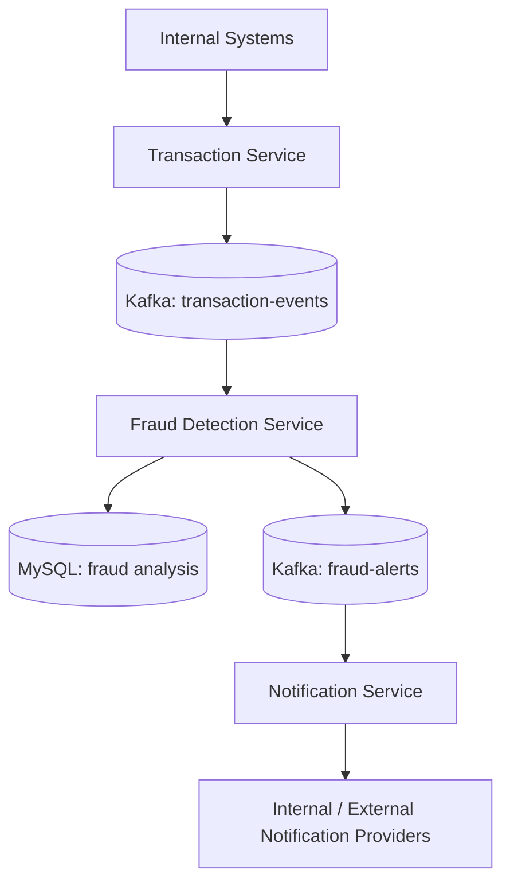

# Architecture — Fraud Detection System

## 1. Visão geral

O sistema será composto por três microsserviços independentes, comunicando-se por eventos Kafka.



## 2. Responsabilidades

### Transaction Service

- Receber transações por API.
- Validar dados de entrada.
- Registrar a transação, conforme política de persistência definida.
- Publicar `TransactionCreated`.

### Fraud Detection Service

- Consumir eventos de transação.
- Aplicar regras antifraude.
- Classificar o risco.
- Persistir o resultado da análise.
- Publicar `FraudDetected` quando aplicável.

### Notification Service

- Consumir alertas antifraude.
- Encaminhar notificações aos canais configurados.
- Registrar o estado da tentativa de notificação.
- Tratar falhas do provedor sem bloquear o motor de detecção.

## 3. Arquitetura Hexagonal

Cada microsserviço seguirá Ports and Adapters.

- **Domain:** entidades, objetos de valor e regras de negócio.
- **Application:** casos de uso e orquestração.
- **Ports:** interfaces de entrada e saída.
- **Adapters:** integrações REST, Kafka, MySQL e provedores externos.

O domínio não deve depender de Spring, Kafka ou MySQL. Os casos de uso dependem de interfaces; adaptadores implementam essas interfaces.

Estrutura ilustrativa:

```text
src/main/java/com/company/service/
├── domain/
│   ├── model/
│   └── service/
├── application/
│   ├── usecase/
│   └── port/
│       ├── input/
│       └── output/
└── infrastructure/
    └── adapter/
        ├── input/
        │   ├── rest/
        │   └── kafka/
        └── output/
            ├── persistence/
            ├── kafka/
            └── provider/
```

## 4. Comunicação

- REST para entrada de transações no Transaction Service.
- Kafka para comunicação assíncrona entre serviços.
- Contratos de eventos versionados.
- Consumidores devem ser idempotentes, usando tabela inbox (ADR 0001, decisão 6).
- Entrada REST exige `Idempotency-Key` (ADR 0001, decisão 1).

## 5. Persistência

MySQL será utilizado para dados duráveis, histórico e auditoria. Cada serviço é proprietário dos próprios dados. É possível iniciar com uma instância compartilhada e schemas/tabelas segregados, sem acesso direto de um serviço às tabelas internas de outro.

Redis não será obrigatório na primeira versão. Será avaliado se métricas de desempenho justificarem contadores temporários ou cache.

## 6. Resiliência

- Retry com backoff para falhas transitórias, com limites definidos.
- DLQ para mensagens que não puderem ser processadas após as tentativas.
- Idempotência para evitar efeitos duplicados.
- Monitoramento de consumer lag, taxa de erro e latência.
- Circuit Breaker poderá ser aplicado nas integrações externas quando necessário.

## 7. Consistência entre banco e Kafka

O Transaction Service utiliza o padrão Transactional Outbox desde a primeira versão (ADR 0001, decisão 5). A transação e o evento `TransactionCreated` são gravados na mesma transação de banco; um publicador envia os registros pendentes ao Kafka reutilizando o `eventId` persistido.

A publicação do outbox é feita por polling com `SKIP LOCKED` (ADR 0003). CDC (Debezium) não faz parte da primeira versão e só será avaliado por gatilho medido.

## 8. Observabilidade

Monitorar, no mínimo:

- Throughput de entrada e processamento.
- Latência p50, p95 e p99.
- Consumer lag por consumer group e partição. É o sinal de capacidade dos consumidores.
- Latência de publicação (do registro no outbox ao ack do Kafka) e de consumo (da publicação ao fim do processamento).
- Latência ponta a ponta do recebimento da transação à publicação do alerta, com p50, p95 e p99 (meta de 500 ms, ADR 0008 §2.8).
- Erros e retries.
- Mensagens em DLQ.
- Saúde dos bancos e provedores externos.

## 9. Segurança e privacidade

A implementação deverá validar autenticação e autorização dos produtores/consumidores, proteger dados em trânsito e em repouso, minimizar dados pessoais nos eventos e logs e validar requisitos aplicáveis da LGPD antes de produção.
